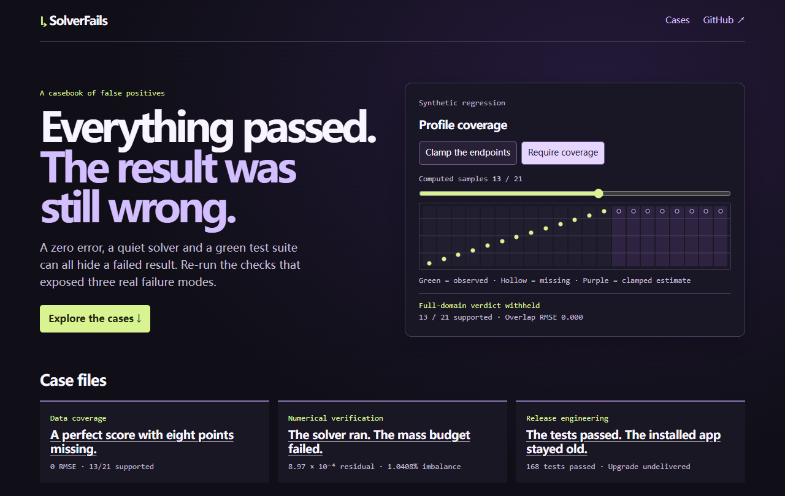

# SolverFails

**Can you trust 64 samples?** [Play the sampling challenge](https://hengyuhang61-creator.github.io/solverfails/challenge.html). Accept or reject an estimate, reveal the curve, move the check samples and export a standalone Python regression. You can send a round to another reviewer using its share link.

The equal-budget sweep contains 7,040 constructed inputs. Shifting the second grid reduces false accepts from 56 to 6 among the low integer frequencies but raises them from 12 to 68 among half-integer frequencies. Both checkers can accept a result wrong by one. Run `node challenge/sweep.mjs` to reproduce the counts or `python challenge/verify.py` for an independent geometric-series check. [Protocol and error denominators](challenge/PROTOCOL.md).

[Open the grid and survey cases](site/witnesses.html) in a local checkout, or run the following command from the repository root. Python 3.9+ and its standard library are sufficient.

```sh
python replay/witness.py
```

The released Poiseuille test accepts order 1.99973 while the reported continuum error is 0.00454193 against an analytical zero. Two recorded AI hearings cite the right survey but change its denominator. Compare each baseline with its independent check, its repair and a passing control. A quadrature stress case also shows where the revised numerical check fails.

Run `python replay/witness.py summary` for false acceptances, false rejections and abstentions, or `python replay/witness.py json` for individual inputs and decisions. Unpack a source download and open `site/witnesses.html` directly for the offline interactive page. [Experimental design](replay/DESIGN.md) · [Source replay and limitations](replay/README.md) · [Submit a public pointer and receive case credit](CONTRIBUTING.md).

[Coordinate matching case](replay/COORDINATE_WITNESS.md) replays a pinned upstream comparison that gives zero error across different CFD stations, and shows when explicit identity and support allow a score.

[Outlet traction case](replay/OUTLET_TRACTION.md) runs a standalone regression in which equal outlet mass flow hides an incorrect local transverse momentum update.

The native Mach 5 replay compares two SU2 checkpoints. Both pass total mass checks while the separation point moves 7.20 mm. [Try the Mach 5 replay](https://hengyuhang61-creator.github.io/solverfails/mach5-drift.html).

[Open the interactive casebook](https://hengyuhang61-creator.github.io/solverfails/) · [Release](https://github.com/hengyuhang61-creator/solverfails/releases/latest) · [Report an issue](https://github.com/hengyuhang61-creator/solverfails/issues/new) · [中文](README.zh-CN.md)



| Case | Evidence |
| --- | --- |
| [A perfect score with eight points missing](https://hengyuhang61-creator.github.io/solverfails/coverage.html) | A synthetic regression verified against the released audit code |
| [The solver ran. The mass budget failed](https://hengyuhang61-creator.github.io/solverfails/conservation.html) | Selected scalar outputs from a Fluent checkpoint |
| [The tests passed. The installed app stayed old](https://hengyuhang61-creator.github.io/solverfails/deployment.html) | A redacted historical handover and a synthetic version probe |
| [The mass budget passed. The separation point kept moving](https://hengyuhang61-creator.github.io/solverfails/mach5-drift.html) | New SU2 restart holds at 7.20 mm of local drift despite low total mass error |

## Audit a survey of your own

The [survey-denominator skill](skills/survey-denominator/SKILL.md) accepts exact response counts and distinguishes entailed, contradicted and underdetermined population claims. Download the standalone skill ZIP from [v0.4.0](https://github.com/hengyuhang61-creator/solverfails/releases/tag/v0.4.0). Unpack its `survey-denominator` folder into your agent’s skills directory. The script also works directly with Python 3.9+.

```sh
python skills/survey-denominator/scripts/survey_bounds.py --affected 18 --respondents 100 --population 200 --claim-percent 18 18
```

These illustrative counts permit population rates from 9% to 59%. The actual clinic record reports only a percentage of respondents.

## Replay locally

Use Node.js 24 or compatible. No npm installation is required.

```sh
node checks.mjs coverage 13
node checks.mjs coverage 21
node checks.mjs conservation
node checks.mjs deployment stale
node checks.mjs mach5-drift
node --test checks.test.mjs
```

Exit 0 means the criterion was met, exit 1 means the claim was rejected, and exit 2 means invalid input. The 13-point coverage, conservation, stale deployment and Mach 5 drift fixtures deliberately return 1. To use the browser interface locally, run `python -m http.server 8000 --directory site` and open http://localhost:8000.

[Watch the UI demo](media/demo.gif) · [Sources and rights](THIRD_PARTY_NOTICES.md) · [English and Chinese launch copy](PROMOTION.md) · [MIT license](LICENSE)
